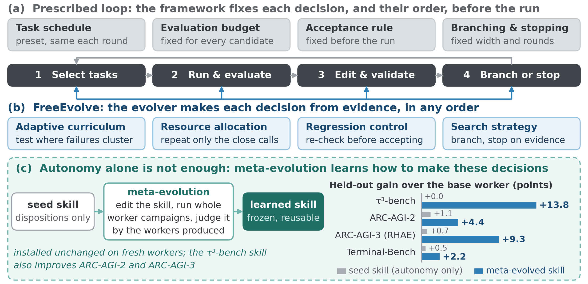
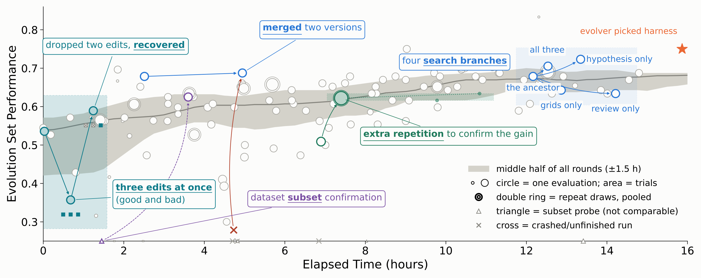

# FreeEvolve

**Learning to Evolve Beyond Fixed Loops**

FreeEvolve turns the optimization process of agent evolution into an agent
capability. Instead of placing an evolver inside a human-designed search loop,
it gives the evolver a bounded environment and lets it decide what to test, how
much evidence to collect, which candidates to pursue, and when to stop. The
resulting evolution skill can itself be improved through meta-evolution.

**[Project page and interactive demo](https://freeevolve.github.io/)** |
**[Video](https://freeevolve.github.io/#video)** |
**[arXiv](https://arxiv.org/abs/2610.09197)** |
**[PDF](https://arxiv.org/pdf/2610.09197)** |
**[Code](https://github.com/amazon-science/FreeEvolve)**

[](https://freeevolve.github.io/#video)

*Watch the [FreeEvolve overview video](https://freeevolve.github.io/#video).
FreeEvolve gives campaign control to the evolver, and meta-evolution turns that
autonomy into a learned, reusable evolution skill.*

## Quickstart

FreeEvolve ships as a Claude Code plugin. Clone the repository and load the
plugin:

```bash
git clone https://github.com/amazon-science/FreeEvolve.git
cd FreeEvolve
claude --plugin-dir .
```

Then start the guided launcher from Claude Code:

```text
/freeevolve:launch
```

The launcher introduces the available environments and evolution skills, checks
their prerequisites, selects the Claude provider and model, and prepares a run
directory. It can launch worker evolution, launch meta-evolution, or adapt a
user-provided agent and evaluator to FreeEvolve. It also inspects both the local
machine and an available Slurm scheduler, so a missing login-node service such
as Docker does not block a campaign that should run on a compute node.

For a fast installation and credential check, select the `dummy` environment.
For practical evolution, select the bundled `strong` skill; select `seed` when
studying or reproducing meta-evolution from its minimal starting point.

## What FreeEvolve Changes

Most agent evolvers can edit prompts, skills, workflows, or code, but the
surrounding framework still prescribes how improvement proceeds. It fixes which
tasks are evaluated, how often measurements are repeated, how candidates are
compared, and when search stops.

FreeEvolve separates this improvement environment from the evolver. The
environment defines the editable target, evaluation function, data, valid
controls, hardware, and resource constraints. Within that boundary, control
returns to the evolver after every execution. The evolver can change evaluation
resolution, open or abandon branches, combine discoveries, reallocate
resources, revisit earlier decisions, and stop when the available evidence
supports doing so.

Campaign autonomy makes these adaptive strategies possible, but does not by
itself teach an evolver how to use them. FreeEvolve therefore represents the
evolver as an editable evolution skill and applies the same framework one level
up: a meta-evolver improves that skill by evaluating the workers it produces.
The optimization process becomes a learned and reusable capability, rather than
a loop that must be redesigned for each agent or environment.

## Paper Highlights

- **Strong agent evolution.** Across `tau3`, ARC-AGI-2, ARC-AGI-3, and
  Terminal-Bench 2.1, FreeEvolve improves the primary held-out metric by
  **13.6 percentage points on average**.
- **Competitive with hand-designed evolvers.** FreeEvolve matches or exceeds
  the compared evolvers on **six of seven held-out metrics**, including systems
  whose search procedures are themselves meta-evolved.
- **Meta-evolution learns better campaign control.** On fresh workers, the
  frozen meta-evolved skill adds **6.9 points over the seed skill** and improves
  every available pass@3 metric.
- **The learned skill transfers.** Skills transfer across agent environments
  and worker models, while the same skill interface works with local and
  Slurm-backed execution. Joint meta-evolution over `tau3` and Terminal-Bench
  2.1 produces a skill that improves every tested target metric over the seed.
- **Improvement remains efficient after transfer.** On ARC-AGI-3, a transferred
  skill reaches **90.6 training RHAE at 0.74B total tokens**, while the strongest
  compared baseline reaches 81.7 after 1.3B. RHAE is Relative Human Action
  Efficiency.

The campaign traces show the evolver constructing behavior normally encoded in
an external loop: starting with inexpensive probes, escalating promising
candidates, repeating noisy measurements, merging complementary discoveries,
undoing regressions, and reallocating work as evidence unfolds.



*One ARC-AGI-2 campaign under a frozen meta-evolved skill. The evolver chooses
when to probe, repeat, merge, branch, recover, and stop as evidence arrives.*

## How It Works

One FreeEvolve campaign has three pieces:

1. **An environment** installs an editable target, exposes an evaluation
   function, and declares the valid data and resource boundary.
2. **An evolution skill** is invoked once. It edits the target and calls the
   evaluation function whenever and however the current evidence warrants.
3. **Meta-evolution**, when requested, makes the evolution skill the editable
   target. Each evaluation of a candidate skill runs a complete worker-evolution
   campaign and returns the resulting worker evidence.

The same interface is used for local worker evolution, Slurm-backed
meta-evolution, and new user-defined environments. Environment-specific
execution belongs in the environment adapter; the evolution skill does not need
to be rewritten.

## Detailed Use Guide

### Choose an evolution skill

The repository includes:

| Skill | Path | Intended use |
| --- | --- | --- |
| `seed` | [`freeevolve/SKILL.md`](freeevolve/SKILL.md) | Minimal starting skill for studying and reproducing meta-evolution |
| `strong` | [`artifacts/evolution-skills/strong/SKILL.md`](artifacts/evolution-skills/strong/SKILL.md) | Strong general skill produced by meta-evolution |
| ARC-AGI-3 artifact | [`artifacts/evolution-skills/arc-agi-3/SKILL.md`](artifacts/evolution-skills/arc-agi-3/SKILL.md) | Additional environment-specific evolved skill |

The launcher recommends `strong` for practical use and never silently
substitutes it for `seed`.

### Choose a provider and evolver model

FreeEvolve supports Claude Code through either Amazon Bedrock or regular
Anthropic authentication:

```text
/freeevolve:launch dummy /tmp/freeevolve-bedrock --provider bedrock
/freeevolve:launch dummy /tmp/freeevolve-anthropic --provider anthropic
```

Use `--model <id-or-alias>` to override the provider-specific default. With no
explicit selection, the launcher detects the configured provider and reports
the resolved model before a paid run.

This choice controls the model that executes the evolution skill. Published
benchmark environments separately retain the worker, user-simulator, and judge
models declared by their own configurations.

The direct runner uses these variables:

| Variable | Meaning |
| --- | --- |
| `FREEEVOLVE_MODEL_PROVIDER` | `auto`, `bedrock`, or `anthropic` |
| `EVOLVER_MODEL` | Claude Code model ID or alias for the evolver |
| `INNER_EVOLVER_MODEL` | Optional global model override for inner meta-evolution campaigns |
| `INNER_EVOLVER_MODEL_<ENV>` | Optional environment-specific inner-model override |
| `AWS_REGION` | Bedrock region; defaults to `us-west-2` |

Each run records the resolved non-secret configuration in
`.freeevolve-model.env` and `.claude/settings.json`. Credentials are never
written to those files.

### Select an environment

Run `/freeevolve:launch` without arguments to receive the current catalog. The
main bundled environments are:

| Environment | Purpose |
| --- | --- |
| `dummy` | Small smoke test with no benchmark data or containers |
| `tau3` | Customer-service tool-use agent evolution |
| `arc_agi_2` | ARC-AGI-2 solver evolution |
| `arc_agi_3` | ARC-AGI-3 interactive-agent evolution |
| `tb2_1` | Terminal-Bench 2.1 agent evolution |
| `tb2_da` | Terminal-Bench 2 with the deep-agents harness |
| `frontier_cs` | Frontier-CS coding-agent evolution |
| `hle` | Humanity's Last Exam agent evolution |
| `meta_chain_local` | Meta-evolution with inner campaigns executed locally |
| `meta_chain` | Meta-evolution with inner campaigns dispatched through Slurm |

The launcher checks only the requirements relevant to the selected
environment. Published benchmark environments target Linux and may require
Docker, `uv`, Claude Code, benchmark credentials, and model access. See the
[running guide](docs/running.md) for the complete environment catalog and setup
details.

### Run worker evolution

For the guided path, invoke:

```text
/freeevolve:launch
```

Choose a worker environment, the starting evolution skill, the provider and
model, and a run directory outside the repository's `freeevolve/` source
directory. The launcher summarizes the edit surface, metric, worker-model
roles, resource boundary, and prerequisites before invoking one autonomous
campaign.

The launcher can also receive those choices directly:

```text
/freeevolve:launch tau3 /tmp/freeevolve-tau3 --skill strong --backend local
```

For Slurm, select the backend and partition:

```text
/freeevolve:launch tau3 /shared/freeevolve-tau3 \
  --skill strong --backend slurm --partition <partition>
```

The launcher checks the submission host separately from the execution host. It
runs one short preflight on the selected compute partition to verify the shared
paths, Docker when required, Claude provider and model access, and other runtime
commands. Only after that check succeeds does it submit the campaign through
`freeevolve/submit_evolve.sbatch`.

Built-in task splits and benchmark constraints are versioned environment assets.
The launcher does not rewrite them. Where the source records held-out task IDs,
the environment installer excludes those tasks and identifiers from the
evolution run.

### Adapt a custom agent and evaluator

Point the launcher at an existing project:

```text
/freeevolve:launch /path/to/your-agent-project
```

The launcher inspects the project and proposes an environment adapter defining:

- the file or directory the evolver may edit;
- the evaluator command and immutable benchmark assets;
- the primary metric and result artifacts;
- useful controls such as subsets, repetitions, seeds, concurrency, and
  timeouts;
- fixed model, hardware, time, and integrity constraints.

The adapter is validated before launch and remains separate from the
FreeEvolve core. Once a custom environment is available, it can also be
selected as an inner environment for meta-evolution.

See the [environment contract](skills/launch/references/environment-contract.md)
and the [framework design](freeevolve/README.md) for the required files and run
directory interface.

### Summarize an evolution run

The launcher can inspect a completed or active run without changing it:

```text
/freeevolve:launch --summarize /path/to/run-directory
```

It reads the environment definition, evolution skill, model configuration,
agent trace, workspace notes and checkpoints, evaluation artifacts, scheduler
logs, and final selected artifact. The summary reports how much the worker or
skill improved, whether the measurements were reliable, the important campaign
decisions, and evidence-backed strategies such as subset probing, repeated
measurement, branching, merging, rollback, resource reallocation, and
evidence-based stopping.

### Run meta-evolution

Meta-evolution edits `SKILL.md` rather than a worker. Each evaluation of a
candidate skill is one complete worker-evolution campaign, and the resulting
worker, score, artifacts, and trace become evidence for improving the skill.

Use `meta_chain_local` when inner campaigns should execute on the current
machine:

```text
/freeevolve:launch meta_chain_local /tmp/freeevolve-meta
```

Use `meta_chain` when inner campaigns should be submitted to Slurm:

```text
/freeevolve:launch meta_chain /shared/freeevolve-meta
```

The launcher asks which existing worker environments supply the
meta-evolution experience. Selecting `tau3,arc_agi_3`, for example, makes both
environments available to the meta-evolver:

```bash
META_INNER_ENVS=tau3,arc_agi_3 \
FREEEVOLVE_MODEL_PROVIDER=bedrock \
bash freeevolve/evolve.sh meta_chain_local /tmp/freeevolve-meta
```

Different data does not require a new meta-evolution implementation. Add or
adapt one ordinary worker environment, then include its name in
`META_INNER_ENVS`.

Both meta-environments allow an improved worker from one inner campaign to seed
the next. Their only intended difference is the execution backend:

| Environment | Backend | Requirements |
| --- | --- | --- |
| `meta_chain_local` | Current machine | Requirements of the selected inner environments |
| `meta_chain` | Slurm | `sbatch`, `squeue`, and storage visible to compute nodes |

`meta_chain` is the canonical protocol. `meta_chain_local` preserves that
protocol while dispatching inner campaigns directly instead of through Slurm.
The evolver and evolution skill remain unchanged.

### Use the direct runner

The complete non-interactive interface is:

```bash
bash freeevolve/evolve.sh <environment-name-or-path> <run-directory> [skill-file]
```

Examples:

```bash
# Seed skill on the smoke-test environment.
bash freeevolve/evolve.sh dummy /tmp/freeevolve-dummy

# Regular Anthropic Claude Code for the evolver.
FREEEVOLVE_MODEL_PROVIDER=anthropic \
bash freeevolve/evolve.sh dummy /tmp/freeevolve-anthropic

# Strong bundled skill.
bash freeevolve/evolve.sh \
  tau3 /tmp/freeevolve-tau3 \
  artifacts/evolution-skills/strong/SKILL.md

# Environment-specific evolved skill.
bash freeevolve/evolve.sh \
  arc_agi_3 /tmp/freeevolve-arc3 \
  artifacts/evolution-skills/arc-agi-3/SKILL.md
```

Runs must live outside the `freeevolve/` source directory. The launcher remains
the recommended entry point because it validates prerequisites and makes the
environment, skill, model, and resource choices explicit before execution.

## Repository Layout

```text
.claude-plugin/       Claude Code plugin manifest
skills/launch/        guided launcher and environment-adaptation workflow
freeevolve/
  SKILL.md            seed evolution skill
  evolve.sh           one autonomous evolution campaign
  envs/               built-in environment assets
  lib/                pinned external-checkout helpers
artifacts/
  evolution-skills/   strong and environment-specific evolved skills
  evolved-agents/     evolved agent edit surfaces
docs/running.md       prerequisites, environment setup, models, and cluster use
```

See the [artifact guide](artifacts/README.md) for the bundled outputs, the
[running guide](docs/running.md) for operational details, and the
[framework design](freeevolve/README.md) for the environment and run-directory
contracts.

## Citation

```bibtex
@misc{kong2026freeevolve,
  title         = {FreeEvolve: Learning to Evolve Beyond Fixed Loops},
  author        = {Kong, Lecheng and Hui, Like and Kanakaris, Nikos and
                   Jana, Prithwish and Genc, Sahika and Sadagopan, Narayanan},
  year          = {2026},
  eprint        = {2610.09197},
  archivePrefix = {arXiv},
  primaryClass  = {cs.AI},
  url           = {https://arxiv.org/abs/2610.09197}
}
```

## Security

See [CONTRIBUTING](CONTRIBUTING.md#security-issue-notifications) for reporting
security issues. FreeEvolve executes agent-written code and benchmark harnesses;
run it only in appropriately isolated environments.

## License

This project is licensed under the Creative Commons
Attribution-NonCommercial 4.0 International License. See [LICENSE](LICENSE).
